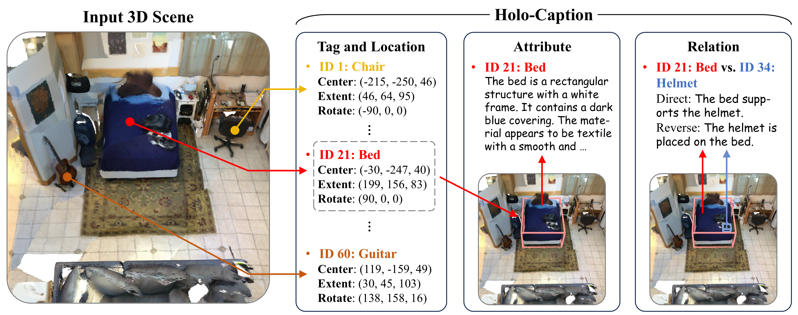

<div align="center">
<h1>Holo-Captioning: Toward the Text Equivalent of 3D Scenes</h1>
<h3 align="center">ECCV 2026</h3>

<a href="https://arxiv.org/abs/2607.02908" target="_blank" rel="noopener noreferrer">
  
</a>
<a href="https://arxiv.org/abs/2607.02908">
  
</a>
<a href="https://visual-ai.github.io/holocap/">
  
</a>
<a href="https://huggingface.co/datasets/LasNack/HoloScan">
    
</a>

**[Visual AI Lab, HKU](https://visual-ai.github.io/)**

[Kun-Yu Lin](https://kunyulin.github.io/)<sup>1</sup>, [Chengke Bu](https://openreview.net/profile?id=%7EChengke_Bu1)<sup>1</sup>, [Zhenguo Li](https://zhenguol.github.io/)<sup>2</sup>, [Kai Han](https://www.kaihan.org/)<sup>1</sup>

<sup>1</sup> Visual AI Lab, The University of Hong Kong &nbsp;&nbsp; <sup>2</sup> Frontier Robotics
</div>

## 📢 Updates
- [2026/09/01] 🔥Released the HoloCap code.
- [2026/09/01] 🔥Released the HoloScan benchmark.
- [2026/07/03] 🎉The paper was released on arXiv.

## 🌈 Overview

#### TL;DR
- A new 3D scene captioning task that seeks the text equivalent of 3D scenes.



- Holo-captioning generates structured textual descriptions of all entity instances in a 3D scene across four dimensions: semantic tags, spatial locations, attributes, and inter-entity relations.
- HoloScan provides more than 15K real and synthetic indoor scenes, including over 13K training scenes, 619 validation scenes, and 83 human-curated test scenes.
- HoloScribe follows an instance-aware decoupled pipeline to discover entities, link relational instance pairs, and generate grounded attribute and relation descriptions.
- HoloScore evaluates generated holo-captions through grounded instance matching and granular descriptor comparison.

#### Contributions
- A new holo-captioning task with a comprehensive HoloScore metric.
- An instance-centric HoloEngine and the large-scale HoloScan benchmark.
- HoloScribe, a 3D LLM that jointly localizes entity instances and generates detailed descriptions in pure text form without extra detectors.

## 💪 Environment
Please refer to [README_ENV.md](README_ENV.md) for environment configuration.

## 📚 Data Preparation
HoloScan combines real and synthetic indoor scenes from [ScanNet](http://www.scan-net.org/), [3RScan](https://waldjohannau.github.io/RIO/), [Matterport3D](https://niessner.github.io/Matterport/), [ARKitScenes](https://github.com/apple/ARKitScenes), and [Structured3D](https://structured3d-dataset.org/).

The HoloScan training annotations, validation and test annotations, and axis-alignment metadata are available on [Hugging Face](https://huggingface.co/datasets/LasNack/HoloScan). The original meshes must be downloaded separately from their official providers under the respective access terms.

Please refer to [README_DATA.md](README_DATA.md) for the official raw-data downloads, required directory layouts, and axis-aligned point-cloud generation.

## 🚀 Model: HoloScribe
HoloScribe follows an instance-aware decoupled pipeline. Given a point-cloud scene, it discovers grounded entity instances, identifies relational instance pairs through anchor-aware instance linking, and generates grounded attribute and relation descriptions.

### 🚝 Training
HoloScribe is initialized from [SpatialLM1.1-Qwen-0.5B](https://huggingface.co/manycore-research/SpatialLM1.1-Qwen-0.5B). The training script is configured to use six GPUs (`0-5`). After configuring the environment and data paths, run:

```shell
conda activate holocap
bash scripts_train/train_holocap.sh
```

The training configuration is defined in [configs/holocap-qwen2.5-0.5b-lora.yaml](configs/holocap-qwen2.5-0.5b-lora.yaml).

### 🚝 Inference
Both inference scripts are configured to use two GPUs (`0,1`).

Use the following script for inference on the *validation* set:

```shell
conda activate holocap
bash scripts_infer/infer_val.sh
```

Use the following script for inference on the *test* set:

```shell
conda activate holocap
bash scripts_infer/infer_test.sh
```

Inference outputs are stored under `results/holocap-qwen2.5-0.5b-lora/`.

## 🛸 Metric: HoloScore
HoloScore evaluates holo-captions across semantic tagging, spatial localization, entity attributes, and inter-entity relations. It performs grounded instance matching, decomposes long descriptions into granular descriptors, and compares attribute and relation descriptors through dual descriptor matching.

Please follow the HoloScore environment instructions in [README_ENV.md](README_ENV.md).

### 🔦 Evaluation
Both evaluation scripts are configured to use two GPUs (`0,1`).

On the first evaluation run, each script generates and caches the split's reference atomic attributes under `results_eval/`. Subsequent runs reuse the cached references.

Evaluate the *validation* set with:

```shell
conda activate holocap-eval
bash scripts_holoscore/evaluate_val.sh
```

Evaluate the *test* set with:

```shell
conda activate holocap-eval
bash scripts_holoscore/evaluate_test.sh
```

HoloScore intermediate results are stored under `results_eval/`. The aggregate metrics are printed directly to the terminal.

## 📌 Citation
For any question, please contact [Kun-Yu Lin](mailto:kunyulin14@outlook.com). If you find this work useful, please star this repo and cite our work as follows:

```bibtex
@inproceedings{lin2026holocap,
    title={Holo-Captioning: Toward the Text Equivalent of 3D Scenes},
    author={Lin, Kun-Yu and Bu, Chengke and Li, Zhenguo and Han, Kai},
    booktitle={European Conference on Computer Vision},
    year={2026}
}
```

## 🌟 Acknowledgements
Thanks to these great repositories and datasets: [SpatialLM](https://github.com/manycore-research/SpatialLM), [EmbodiedScan](https://github.com/OpenRobotLab/EmbodiedScan), [ScanNet](http://www.scan-net.org/), [3RScan](https://waldjohannau.github.io/RIO/), [Matterport3D](https://niessner.github.io/Matterport/), [ARKitScenes](https://github.com/apple/ARKitScenes), and [Structured3D](https://structured3d-dataset.org/).
